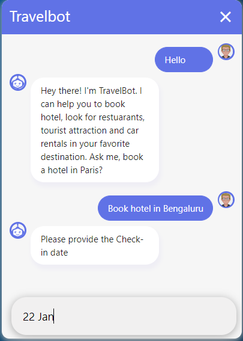
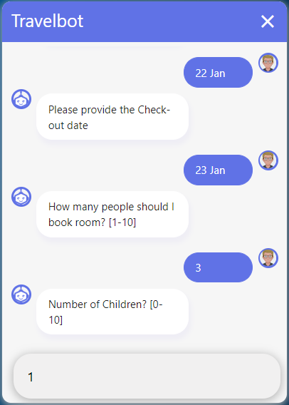
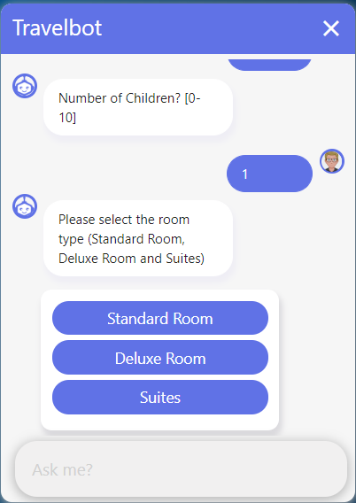
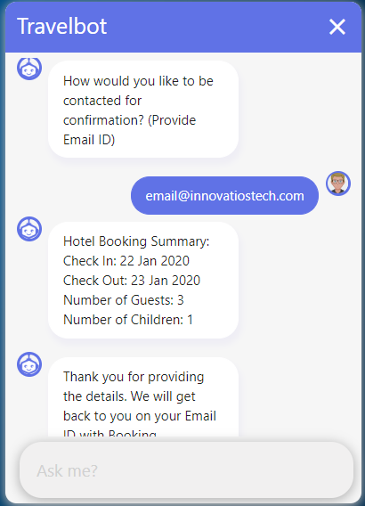
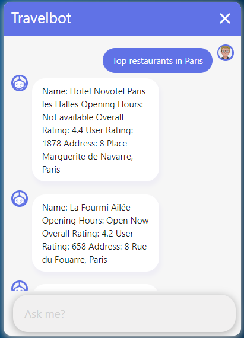
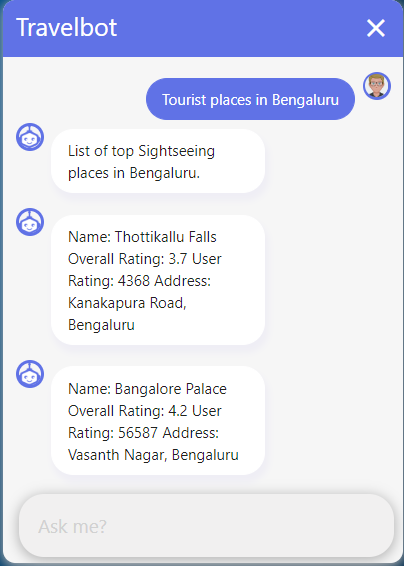
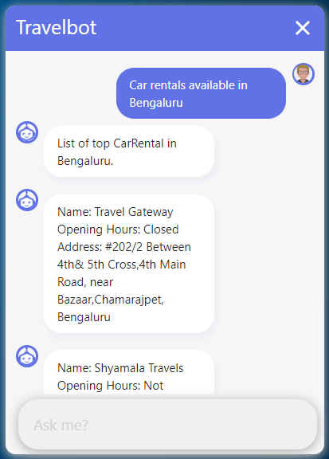

# TravelBot

## Configuration (secrets)

The Google Maps key is read from the `GOOGLE_MAPS_API_KEY` environment variable.
Copy `.env.example` to `.env`, fill it in, and export it before starting the action server
(`set -a; . ./.env; set +a; rasa run actions`). `.env` is git-ignored. The key that was
previously hard-coded in git history must be rotated at the provider and not reused.
